<p align="center">
  <picture>
    <source media="(prefers-color-scheme: dark)" srcset="logo_fundo_escuro.webp">
    
  </picture>
</p>

<h1 align="center"></h1>

<p align="center">
  Sistema de gestão para pequenas lojas: vendas, caixa, estoque, clientes e financeiro<br>
  em uma página só, servido por um servidor local na rede da loja.
</p>

<p align="center">
  
  
  
  
</p>

---

## Sobre

O CRM GESTOR é um sistema de frente de caixa e gestão feito para o dia a dia de uma
loja. Ele roda inteiro no computador da loja, sem mensalidade de nuvem e sem depender
da internet: o computador principal vira o servidor, e o celular e os outros
computadores da mesma Wi-Fi abrem o sistema pelo navegador.

- **Uma página só.** O sistema é o `index.html`, com o JavaScript dentro.
- **Servidor local em Python.** Guarda os dados, controla login e permissões, e
  atende os aparelhos liberados da rede da loja.
- **Leva no bolso.** Funciona também de um pen drive ou HD externo, com Python
  portátil.
- **Nada instalado à força.** O pacote traz o próprio Python; o navegador é o Chrome
  ou o Edge que já estão no computador.

## Funcionalidades

| Área | O que tem |
|---|---|
| **Vendas** | PDV (frente de caixa), histórico de vendas, caixa com abertura e fechamento, fiado, formas de pagamento, cupom |
| **Comercial** | Clientes, orçamentos, agenda, projetos (quadro A fazer → Concluída) |
| **Estoque e compras** | Produtos, etiquetas, compras, fornecedores, categorias |
| **Administrativo** | Financeiro, relatórios, dashboard, colaboradores e setores |
| **Sistema** | Usuários com níveis de permissão, banco de dados e backup, cópia diária automática, anexos, várias empresas no mesmo computador |
| **Ajuda** | Central de ajuda dentro do sistema, manual em PDF, novidades por versão, saúde do sistema |
| **Ferramentas** | Calculadora de preços, favoritos e outros atalhos de apoio |

### Segurança

- Dados só com login; senhas guardadas com PBKDF2 e que nunca saem do servidor.
- Permissões conferidas no servidor, não só na tela: cada operação é recusada ou
  filtrada conforme o nível do usuário.
- Aparelhos da rede precisam ser liberados um a um, com código de 6 números que vale
  10 minutos.
- A porta do servidor fica aberta só para a rede local privada da loja.

## Requisitos

- Windows 10 ou 11
- Google Chrome ou Microsoft Edge
- Para desenvolver: Python 3 e Node 20 (só para os testes de tela)

## Começando

### Na loja (instalação)

O cliente recebe um `.zip` gerado a partir desta pasta (veja **Gerar o pacote**
abaixo) e segue o `LEIA-ME - instalar.txt` que vem dentro dele:

1. Dois cliques em `Instalar CRM GESTOR.bat`.
2. Abrir o atalho **CRM GESTOR** da área de trabalho, que abre
   `http://localhost:4590/`.
3. Seguir o assistente de primeira configuração.

`Atualizar CRM GESTOR.bat` instala uma versão nova (e volta atrás se algo falhar), e
`Diagnostico do CRM GESTOR.bat` monta um relatório para o suporte.

### No computador de desenvolvimento

```bat
"Abrir CRM GESTOR.bat"
```

Sobe o servidor e abre o sistema no navegador. Para parar, `Parar servidor CRM GESTOR.bat`.

## Testes

```bat
python -X utf8 testes\rodar_testes.py
```

Ou dois cliques em `testes\Rodar testes.bat`. Leva uns 40 segundos e termina com
**"Tudo certo: a versão pode sair"** ou **"Algo falhou"**. Cada parte sobe o próprio
servidor numa porta livre, com uma base fictícia numa pasta temporária: os dados da
loja não são tocados. Detalhes em [`testes/LEIA-ME.md`](testes/LEIA-ME.md).

## Gerar o pacote e o manual

```bat
python -X utf8 servidor\gerar_pacote.py
```

Roda os testes, monta `build\dist\` e o `.zip` de instalação, **limpo**, sem nenhum
dado pessoal. `--sem-testes` pula os testes.

```bat
python -X utf8 servidor\gerar_manual_pdf.py
```

Regrava `docs\CRM GESTOR - Manual do usuario.pdf` a partir da Central de ajuda.
Rodar a cada versão.

## Estrutura do projeto

| Pasta ou arquivo | O que é | Vai para o cliente? |
|---|---|---|
| `index.html` | O sistema inteiro (uma página, com o JavaScript dentro) | sim |
| `servidor/` | O servidor da loja, instalação, atualização, diagnóstico, pen drive e o Python portátil | sim |
| `imagens/`, `ferramentas/`, `juridico/` | Logotipos e ícones, as ferramentas de apoio e os textos jurídicos | sim |
| `backup/` | Cópias anteriores do sistema, feitas a cada mudança | faz parte da instalação |
| `*.bat`, `*.url`, `*.lnk`, `*.ico`, `LEIA-ME - servidor local.txt` | Atalhos e textos que ficam na pasta do sistema | sim |
| `pacote/` | Atalhos e textos que o cliente usa **antes** de instalar (instalar, atualizar, diagnóstico) | sim, no `.zip` |
| `testes/` | Suítes automáticas (`Rodar testes.bat`) | não |
| `docs/` | Manual em PDF, guias, diagramas, revisão do código, plano comercial e planejamento | não |
| `build/` | Saída gerada (o pacote montado). Pode ser apagada e refeita | não |
| `privado/` | O painel do fornecedor e a chave privada das licenças | **nunca** |

Os diagramas do projeto ficam em [`docs/diagramas/`](docs/diagramas/), e o guia
"Onde fica cada coisa" em `docs/Guia - Organizacao das pastas.pdf`.

### Regras de organização

1. Nada que vai para o cliente pode depender de uma pasta fora dela. A instalação
   (`C:\CRM GESTOR\sistema`) tem a mesma forma desde a versão 8.62.
2. O que é gerado (`build/`) não se edita à mão.
3. O que é privado (`privado/`) não entra em pacote, em backup distribuído nem no
   repositório.
4. Histórico de revisão e de comercialização (`docs/revisao`, `docs/comercializacao`)
   pode citar caminhos antigos, como `documentação/`. Esses textos são registro do
   que foi feito, e não são reescritos.

Plano que gerou esta organização: `docs/planejamento/plano_reorganizacao_pastas.md`.

## Documentação

- **Para quem usa:** a Central de ajuda, dentro do sistema, e o
  [manual em PDF](docs/CRM%20GESTOR%20-%20Manual%20do%20usuario.pdf).
- **Rede da loja, pen drive e Google Drive:** os guias ilustrados em [`docs/`](docs/).
- **Servidor local:** [`LEIA-ME - servidor local.txt`](LEIA-ME%20-%20servidor%20local.txt).

## Licença

Software proprietário. Todos os direitos reservados. Cada instalação comercial usa uma
chave de licença própria. Os termos de uso e a política de privacidade estão em
[`juridico/`](juridico/).

